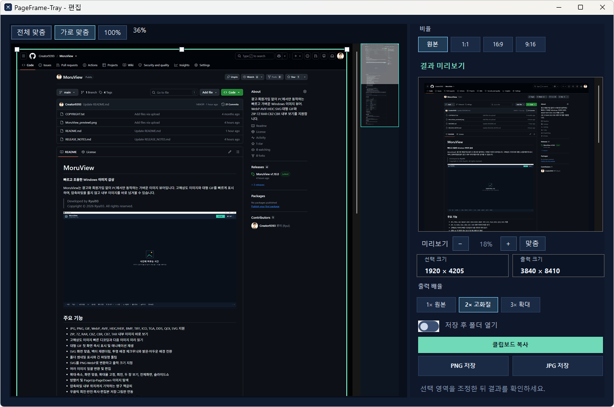

# PageFrame

**웹페이지 전체 캡처부터 편집까지, 가볍게**

PageFrame은 크롬 확장 **PageFrame Capture Studio**와 Windows 트레이 앱 **PageFrame-Tray**로 이루어진 캡처·편집 도구입니다. 확장으로 웹페이지 전체를 한 장으로 캡처하고, 트레이 앱에서 창 캡처와 클립보드 이미지 편집까지 한 번에 할 수 있습니다. 광고, 회원가입, 외부 전송 없이 PC 안에서만 동작합니다.

> Developed by **Ryui93**
> Copyright © 2026 Ryui93. All rights reserved.



## 주요 기능

**PageFrame Capture Studio (크롬 확장)**
- 고화질 렌더링: 브라우저가 페이지 전체를 한 번에 그려서 캡처
- 스크롤 스티칭: 화면을 나눠 찍고 이음새 없이 한 장으로 연결
- 고화질 렌더링이 어려운 페이지는 스크롤 스티칭으로 자동 전환
- 고정 헤더, 떠다니는 버튼, 팝업·쿠키 동의창 자동 숨기기
- 캡처 후 바로 클립보드에 복사
- 간단 편집: 자르기(자유·1:1·16:9·9:16), 배경, 여백, 2배 고화질 출력
- PNG·JPG 저장, 클립보드 복사

**PageFrame-Tray (Windows 트레이 앱)**
- 클립보드 이미지 바로 편집
- 활성 창 캡처 (배경 없이 창만, 둥근 모서리 바깥은 투명)
- 세로로 긴 이미지 편집: 가로 맞춤, 미니맵, 자르기 중 자동 스크롤
- 최근 이미지: 편집본·스크린샷 폴더 썸네일, 원본으로 다시 편집
- 원본 자동 보관 (개수 설정 가능), 다시 편집해도 원본 덮어쓰기 없음
- Windows 시작 시 트레이로 자동 실행
- 창 캡처 결과를 바로 클립보드로 복사 (옵션)

## 설치

**PageFrame-Tray**
1. [Releases](https://github.com/Creator9393/PageFrame/releases)에서 `PageFrame-Tray-v0.8.1.zip`을 내려받습니다.
2. 원하는 폴더에 압축을 풉니다.
3. 실행 중인 이전 PageFrame-Tray가 있으면 트레이 아이콘 우클릭 → 종료합니다.
4. `PageFrameTray.exe`를 실행합니다.

**PageFrame Capture Studio**
1. [Releases](https://github.com/Creator9393/PageFrame/releases)에서 `PageFrame-Capture-Studio-v0.2.0.zip`을 내려받아 압축을 풉니다.
2. 크롬 주소창에 `chrome://extensions`를 입력합니다.
3. 오른쪽 위 **개발자 모드**를 켭니다.
4. **압축해제된 확장 프로그램을 로드합니다**를 눌러 압축을 푼 폴더를 선택합니다.
5. 업데이트할 때는 새 버전 폴더로 덮어쓴 뒤 확장 카드의 새로고침 버튼을 누릅니다.

개인 제작 앱이라 코드 서명이 적용되지 않았습니다. Windows SmartScreen이 표시되면 GitHub 릴리스의 `SHA256SUMS.txt`와 내려받은 파일의 SHA-256 값이 일치하는지 확인하세요. 파일 출처와 값이 확인된 경우 `추가 정보 → 실행`을 선택할 수 있습니다.

크롬 시작 시 "개발자 모드 확장 프로그램 사용 중지" 안내가 뜰 수 있습니다. 닫으면 계속 사용할 수 있습니다.

PowerShell에서 SHA-256 값 확인:

```
Get-FileHash .\PageFrame-Tray-v0.8.1.zip -Algorithm SHA256
```

## 주요 단축키

| 키 | 기능 |
|---|---|
| `Ctrl+Alt+Shift+4` | 클립보드 이미지 편집 |
| `Ctrl+Alt+Shift+5` | 활성 창 캡처 후 편집 |
| `Ctrl+V` | 클립보드 이미지 편집 (메인 창 활성 시) |
| 마우스 휠 | 세로 스크롤 |
| `Shift` + 휠 | 가로 스크롤 |
| `Ctrl` + 휠 | 확대 / 축소 |
| `Esc` | 큰 미리보기 닫기 |

## 시스템 요구사항

- Windows 10/11 x64
- [.NET 8 데스크톱 런타임 (x64)](https://dotnet.microsoft.com/download/dotnet/8.0)
- Chrome 또는 Chromium 기반 브라우저 (확장)

## 알려진 제한

- `chrome://` 페이지와 크롬 웹스토어에서는 확장이 동작하지 않습니다.
- 고화질 렌더링 중 브라우저 상단에 "디버깅 중" 안내가 잠시 표시됩니다.
- 페이지 안쪽 박스만 스크롤되는 사이트나 매우 긴 페이지는 스크롤 스티칭으로 전환됩니다.
- 다른 확장이 페이지에 적용한 효과(흐림 처리 등)는 캡처 결과에도 그대로 남습니다.

## 저작권

Copyright © 2026 Ryui93. All rights reserved.
별도 허가 없이 프로그램 또는 제작자 정보를 변조해 재배포할 수 없습니다.

## 마지막으로

PageFrame을 써 주셔서 고마워요. 버그나 의견은 Issues에 남겨 주세요!

## 후원

PageFrame이 도움이 됐다면 ☕ [Ko-fi로 후원하기](https://ko-fi.com/creator9393)
